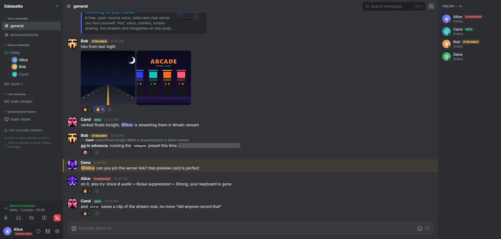

INCIPIT

This software is being built with the sole purpose of me using it with my friends, I don't care if it does not fit your intended use case and I do not plan on ever making any money or similar with it so keep that in mind if you want to use it.



# Datasetto

A self-hosted voice, video, streaming and chat server for a small group of friends: text
channels, peer-to-peer voice with camera and screenshare, OBS streaming with HLS
playback, a few voice-channel minigames, and admin tooling. Runs on one small
VM for about the price of a coffee a week.

## Features

- **Text channels** with persistent history, moderation (delete, ban, voice timeout)
- **Voice channels** over WebRTC mesh: echo cancellation, noise suppression (with an optional neural level that removes keyboard typing and chewing on the device), push to talk, camera, screenshare
- **Live streams**: OBS publishes over RTMPS (or plain RTMP on the LAN), viewers watch low-latency HLS in a theater layout with chat
- **Screenshare rooms** for one presenter and many viewers
- **Minigames** inside voice channels (Slither, Pacman, Fighter) with a persistent leaderboard
- **Accounts and roles**: superuser, admin, moderator, streamer, user; per-channel permissions; invite-only registration
- **Notifications**: Web Push for direct messages and @mentions while the app is hidden (browsers and the installed PWA, opt-in per device); native notifications in the desktop app
- **Clients**: web app, Electron desktop app (`desktop/`), Capacitor Android/iOS app (`mobile/`)

## Repository layout

```
client/    Preact + TypeScript single page app (signals, Tailwind v4, Socket.IO, WebRTC, hls.js);
           public/ holds the landing and downloads pages
server/    Node.js 24 TypeScript API: Express 5 + Socket.IO 4, SQLite (better-sqlite3), zod 4 validation, pino logs
ops/       Docker Compose stack (Caddy, app, nginx-rtmp, coturn), the VPS installer (vps/), Google Cloud scripts (gcp/)
desktop/   Electron shell around the web client
mobile/    Capacitor shell around the web client (the Android and iOS projects are committed)
.github/   workflows: images.yml publishes the container images, release.yml builds installers and the APK
```

Each folder has a README with its own commands and layout. The server is the
source of truth. State that must survive restarts (accounts, sessions,
channels, permissions, messages, bans, leaderboards) lives in one SQLite file;
live state (who is online, voice rooms, active streams) is in memory and
rebuilt as clients reconnect. Media never touches the server except RTMP
ingest and the optional TURN relay.

## Quick start (local)

Requirements: Docker Desktop.

```bash
cp ops/.env.example ops/.env
# for a local test set REGISTRATION_MODE=open and clear REGISTRATION_INVITE_CODE
docker compose -f ops/docker-compose.yml -f ops/docker-compose.local.yml up --build -d
```

Open <http://localhost:8080/app>. The first registered account becomes admin.
OBS: server `rtmp://localhost/live`, stream key from the key dialog of a stream channel.

## Deploy

The live server is a plain VPS running branch `main`. Any Debian or Ubuntu VPS
works the same way. Fill in `ops/.env` (domain, invite code, admin email), then
from the repository root (`<user>` is `root` on Hetzner, `debian` or `ubuntu`
on OVH):

```bash
scp ops/.env <user>@<server-ip>:datasetto.env
ssh <user>@<server-ip> 'curl -fsSLO https://raw.githubusercontent.com/FilippoLeone/datasetto/main/ops/vps/install.sh'
ssh <user>@<server-ip> 'sudo bash install.sh --env ./datasetto.env --ref main'
```

`ops/vps/install.sh` is idempotent: swap, Docker, firewall, the stack as a
systemd unit, nightly SQLite backups. Re-run it with the same `--ref` to
update. A VPS of this class (OVH VPS-1, Hetzner CX23) costs about 4 to 7 EUR
per month.

Google Cloud is the alternative: `ops/gcp/create-vm.sh` creates one `e2-micro`
VM in `europe-west1`, automatic HTTPS via Caddy, nightly SQLite backups to a
bucket, budget alerts. Expected cost: about 10 EUR per month, with the first
200 GB of streaming traffic free and hard caps that keep the bill under about
13 EUR even under abuse; about 3.50 EUR in the US free-tier regions.

Details, cost breakdown, abuse protection and day-two operations:
[ops/README.md](ops/README.md).

## Development

Requirements: Node.js 24 LTS, the version the Docker images and the GitHub workflows use
(22.12 or newer works too, except that jsdom 30 for the client tests needs 22.22+). Run the
server on 24.22.1+ or 22.23.4+, the first releases with the fix for CVE-2026-111497. The client
builds with Vite 8 and tests with Vitest 5; the server runs on Express 5, Socket.IO 4 and zod 4.

```bash
cd server && npm install && cp .env.example .env && npm run dev    # API on :4000, hot reload
cd client && npm install && npm run dev                            # UI on :5173, proxies to the Docker stack on :8080
cd client && npm run typecheck && npm run lint && npm test         # tsc + eslint + vitest
cd server && npm run typecheck && npm test                         # tsc + vitest: services, HTTP, socket protocol
```

Server configuration is documented in [server/.env.example](server/.env.example);
the socket and HTTP protocol in [server/README.md](server/README.md). Shell
scripts and Dockerfiles are kept LF on every platform by `.gitattributes`.

## Desktop and mobile apps

See [desktop/README.md](desktop/README.md) and [mobile/README.md](mobile/README.md).
Both wrap the web client. The desktop shell reads its server URL from
`desktop/resources/runtime-config.json` or `DATASETTO_SERVER_URL`; the mobile
build bakes it in from `client/.env.mobile` (git-ignored, created by you).
Installers for Windows, Linux and macOS and a debug-signed Android APK are
built by `.github/workflows/release.yml` when a GitHub release is created, and
the site's downloads page lists the latest ones.

### Datasetto on iPhone

There is no App Store build (the iOS job of the release workflow is switched
off; shipping one needs a paid Apple developer account). iPhone and iPad use the
web app in Safari, best added to the Home Screen: open the site in Safari, sign
in, tap Share, then Add to Home Screen, and open Datasetto from there. Inside
that Home Screen version, Settings > Notifications turns on push for direct
messages and @mentions (iOS 16.4 or later; Safari tabs have no Web Push).

What works: text channels, pictures, direct messages, live streams (Safari's
own player, with fullscreen through the system player) and voice calls with
camera. What iOS does not allow a web app to do: voice keeps running only
while Datasetto is on screen and pauses when you switch apps or lock the
phone (it picks up again when you come back); the phone chooses between
speaker and earpiece; a friend cannot be played louder than 100 %; screen
sharing is not available. The app says so once, in the voice channel.

## License

GNU AGPLv3, see [LICENSE.md](LICENSE.md).
